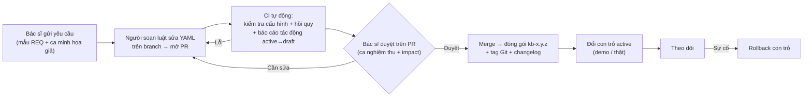
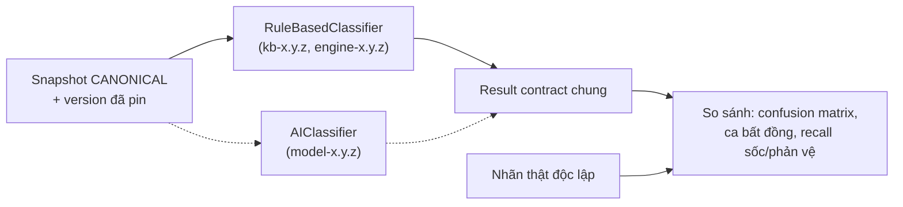

# Phương án mở rộng workflow và pipeline

**Ngày:** 13/10/2026 · **Trạng thái:** đề xuất, chưa triển khai · **Nền:** commit `6e56f2b`, lộ trình cập nhật tại `f868402`, YAML `1.2.1`.

Tài liệu này chuyển các yêu cầu bổ sung thành phương án cụ thể cho repo hiện tại. Nguyên tắc và hợp đồng chi tiết nằm trong [gói hướng dẫn](implementation-guide/README.md); ở đây chỉ chốt **làm gì, đặt ở đâu, theo thứ tự nào**. Mọi ngưỡng/tiêu chí y khoa vẫn do bác sĩ duyệt (decision log D-01..D-11 trong [09](implementation-guide/09-decisions-and-templates.md)).

## 1. Yêu cầu → phương án

| # | Yêu cầu | Phương án | Bước (mục 7) |
| --- | --- | --- | --- |
| R1 | Luật từ bác sĩ thay đổi, cập nhật nhanh và linh hoạt | Giữ DSL YAML; thêm từ điển biến + kiểm tra cấu hình; quy trình thay đổi qua Pull Request có **báo cáo tác động tự động**; sau MVP thêm form chỉnh luật trên web | 1–2 (form web sau MVP) |
| R2 | Đánh version luật | **Gói tri thức bất biến** `knowledge/kb-x.y.z/` + manifest + hash; revision từng rule; con trỏ active theo môi trường; mọi kết quả ghi package/engine version | 1–2 |
| R3 | Web public: demo dữ liệu giả + import dữ liệu thật, phân loại có giải thích | Một ứng dụng, hai khu: **Demo** (public, chỉ ca giả) và **Dữ liệu thật** (đăng nhập, quyền kiểm tra ở server). URL public ≠ dữ liệu thật public | Demo: 4 · Thật: 5 |
| R4 | Trực quan hóa input | Thẻ theo nhóm cơ quan (Có/Không/Chưa biết), timeline thời gian/HA kèm ngưỡng, bảng xét nghiệm, bảng chất lượng dữ liệu, RAW cạnh CANONICAL | 4 |
| R5 | Trực quan hóa kết quả + giải thích | Thẻ trạng thái → nhãn → version → lý do chính → việc cần làm; cây 6 tầng tô màu TRUE/FALSE/UNKNOWN; bằng chứng từng điều kiện; dashboard batch | 4–5 |
| R6 | Kết hợp/so sánh model AI | Giao diện classifier chung + result contract chung; AI chạy **shadow** song song, so sánh trên cùng snapshot; không trộn điểm AI với luật | Sau MVP (contract từ bước 1) |

## 2. Workflow cập nhật luật (R1, R2)



**Vì sao dùng Git/PR cho MVP:** repo đã ở GitHub; PR cho sẵn bản nháp, diff, bình luận, phê duyệt và lịch sử, không cần xây hệ thống quản trị luật riêng. Phần tốn công nhất – báo cáo tác động – được tự động hóa trong CI. Form chỉnh luật trên web (sau MVP) chỉ là giao diện khác tạo cùng bản nháp và đi qua cùng gate.

**Độ linh hoạt theo loại thay đổi** (chi tiết ở [05](implementation-guide/05-rule-versioning-and-change-management.md)):

| Thay đổi | Cách làm | Tốc độ kỳ vọng |
| --- | --- | --- |
| Ngưỡng, giá trị, AND/OR/NOT, ref, priority, nhãn, câu giải thích | Chỉ sửa YAML | Nhanh nhất: PR → CI → duyệt → release |
| Thêm biến mới | Từ điển biến + schema + mapping + UI | Trung bình, cần chủ dữ liệu |
| Toán tử/công thức mới | Code engine + test (allowlist, không `eval`) | Chậm hơn, cần developer |
| Đổi ý nghĩa/đơn vị biến | Version schema/mapping mới + migration | Chậm nhất |

**Việc cần thêm vào repo:**

1. `rules/fields.yaml` – từ điển biến: path, kiểu, đơn vị, enum, cách biểu diễn thiếu, nhóm hiển thị. Dùng chung cho validator, UI và form chỉnh luật sau này.
2. Kiểm tra cấu hình luật khi nạp và trong CI: field có trong từ điển, toán tử hợp với kiểu, ref tồn tại, không vòng (engine đã có một phần).
3. Metadata cho mỗi rule: `revision`, `change_reason`, `clinical_source`, `acceptance_case_ids`.
4. `tools/impact_report.py` – chạy bản active và bản draft trên cùng bộ ca, xuất bảng số ca đổi status/nhãn/rule/missing, tách riêng các ca sốc/phản vệ; CI đăng báo cáo vào PR.
5. Mẫu issue `REQ` (theo [09](implementation-guide/09-decisions-and-templates.md)) trong `.github/ISSUE_TEMPLATE/`.

## 3. Đánh version (R2)

```text
knowledge/
  kb-1.2.1/                  # đã phát hành → bất biến (CI chặn sửa)
    manifest.yaml            # id, version, schema/mapping/preprocess version, engine hỗ trợ, previous
    classification_rules.yaml
    fields.yaml
    mapping.yaml             # khi D-01 chốt
    acceptance_cases.json
  kb-1.3.0-draft/            # bản nháp trên branch
  active.yaml                # demo: kb-1.2.1 · real: kb-1.2.1
```

- **Bốn version tách biệt:** gói tri thức (`kb-x.y.z`), engine (`engine-x.y.z` trong `src/__init__.py`), schema dữ liệu, schema kết quả. Sửa bug engine cũng có thể đổi kết quả nên engine có version riêng.
- **SemVer:** MAJOR = đổi contract/ý nghĩa nhãn; MINOR = đổi hành vi phân loại; PATCH = sửa lỗi/giải thích. Mọi release đều chạy báo cáo tác động.
- **Mỗi kết quả** ghi `knowledge_package_id`, hash, `engine_version`, `run_id`. Engine hiện đã trả `rules_version` + `rules_sha256`; mở rộng thêm, không đổi nghĩa trường cũ.
- **Một batch chỉ dùng một version** từ đầu đến cuối; chạy lại với version mới tạo run mới, không ghi đè kết quả cũ.
- **Rollback** = đổi `active.yaml` về gói trước (kèm engine tương thích).

## 4. Pipeline cập nhật (R3)

Pipeline đích giữ như [mục 0 của workflow](02_workflow.md#0-pipeline-đích-và-thay-đổi-so-với-đặc-tả-0910). Phân bổ vào module trong `src/`:

| Bước | File | Ghi chú |
| --- | --- | --- |
| Nhận file, tạo `import_id`/`record_id`, pin version, tách nhãn/định danh | `src/ingest.py` (mới) | JSON trước; Excel/CSV khi D-01 chốt template |
| Kiểm tra RAW và CANONICAL | `src/validate.py` (đang trống) | Đọc `fields.yaml`; lỗi có path/mã/mức độ, theo từng record |
| Mapping + tiền xử lý có provenance | `src/preprocess.py` (đã bỏ default) + `mapping.yaml` | Mapping chỉ dùng bản được duyệt |
| Khử định danh, snapshot | `src/anonymize.py` | Thêm allowlist trường xuất (D-07) |
| Phân loại | `src/classifiers/rule_based.py` bọc `classify.py` | Giao diện classifier chung cho AI sau này |
| Điều phối batch, đếm đủ số ca | `src/pipeline.py` (đang trống) | Một record lỗi không làm hỏng batch |
| Đánh giá khi có nhãn thật | `src/evaluate.py` (đang trống) | Confusion matrix, theo lớp, báo cả ca chưa kết luận |

Engine và pipeline là thư viện Python thuần, **không phụ thuộc Streamlit**, để web, CLI, batch và AI dùng chung.

## 5. Website (R3, R4, R5)

### Kiến trúc đề xuất: đi theo hai bước

| | Bước A – MVP nhanh | Bước B – khi cần lưu lịch sử/nhiều người dùng |
| --- | --- | --- |
| Giao diện | Streamlit đa trang (mở rộng `main.py` hiện có) | Frontend riêng (ví dụ React) |
| Backend | Gọi trực tiếp thư viện `src/` | API (ví dụ FastAPI) bọc cùng thư viện |
| Đăng nhập | OIDC qua `st.login` của Streamlit (có từ 1.42; repo đang pin 1.50) | Auth provider theo ADR |
| Lưu trữ | **Không lưu** dữ liệu thật: xử lý trong phiên, export rồi bỏ | DB có phân quyền, retention, audit |
| Host | Demo: Streamlit Community Cloud / Hugging Face Spaces từ repo public · Thật: máy chủ được tổ chức cho phép | Theo ADR D-09 |

Lý do: bước A tận dụng demo Streamlit đã có, đưa demo public lên nhanh và cho phép import dữ liệu thật **không cần cơ sở dữ liệu**, nên tránh phần lớn rủi ro lưu trữ. Chuyển sang bước B khi cần lịch sử batch, nhiều vai trò hoặc lưu kết quả – vì logic nằm trong `src/`, chỉ thay lớp giao diện. Lựa chọn cuối cùng ghi thành ADR D-09.

> Dữ liệu thật **không** chạy trên hosting công cộng miễn phí. Khu dữ liệu thật chỉ mở khi D-07 (ai được truy cập, mục đích, lưu/xóa) đã chốt và các gate bảo mật ở [07](implementation-guide/07-testing-security-and-release.md) đạt.

### Các trang

| Trang | Ai dùng | Nội dung |
| --- | --- | --- |
| Demo | Public | Chọn ca giả → xem input trực quan → sửa → phân loại → xem giải thích → tải JSON. Không lưu payload, giới hạn kích thước |
| Import dữ liệu thật | Đăng nhập | Tải template → upload → xem lỗi từng dòng → chạy → bảng kết quả → mở từng ca → export |
| Chi tiết ca | Đăng nhập (ca thật) / public (ca giả) | Trực quan input + kết quả như dưới |
| Luật & phiên bản | Public đọc / người soạn | Danh sách gói, changelog, xem luật dạng cây, báo cáo tác động giữa hai gói |
| So sánh classifier | Sau MVP | Rule-based vs AI trên cùng snapshot |

### Trực quan hóa input (R4)

- **Thẻ theo nhóm cơ quan** (da, hô hấp, tim mạch, tiêu hóa…): mỗi triệu chứng là chip Có / Không / **Chưa biết** – không gộp thiếu với âm tính.
- **Timeline:** ngày khám, khởi phát, thời gian theo dõi; đường HATT theo thời điểm kèm **đường ngưỡng** của gói luật đang dùng (70 + 2×tuổi hoặc 0,7×nền). Giá trị thiếu hiển thị là trống, không vẽ thành 0.
- **Bảng xét nghiệm:** ASST, ELISA IgG/IL-24, test kích thích, ký hiệu chuẩn hóa và giá trị gốc.
- **Chất lượng dữ liệu:** trường thiếu / sai kiểu / mâu thuẫn / đơn vị chưa rõ, bấm để nhảy đến trường đó.
- **RAW ↔ CANONICAL:** hai cột cạnh nhau và danh sách phép chuyển đổi đã áp dụng.

### Trực quan hóa kết quả (R5)

- **Thẻ tóm tắt** theo thứ tự: trạng thái (màu) → nhãn nếu có → gói/engine version → lý do chính → **việc cần làm** (ví dụ "bổ sung `huyet_ap_tam_thu_nen`").
- **Cây 6 tầng** (sốc → phản vệ → cấp → CIndU → CSU → fallback), mỗi rule tô màu TRUE / FALSE / UNKNOWN, đánh dấu rule được chọn, rule cùng khớp nhưng thua priority, rule đang chặn.
- **Bằng chứng từng điều kiện:** mở một rule để xem từng điều kiện, trường dữ liệu, toán tử, kết quả và lý do UNKNOWN.
- **Phân biệt rõ:** khớp nhưng thua priority; UNKNOWN có thể đổi kết luận; xung đột cùng priority; "CSU unknown" (đủ xét nghiệm âm) khác với thiếu xét nghiệm.
- **Dashboard batch:** phân bố trạng thái và nhãn, danh sách ca cần bổ sung/rà soát, confusion matrix khi có nhãn thật.
- Không hiển thị "số điều kiện khớp" như xác suất bệnh.

## 6. Chuẩn bị cho AI (R6)



- **Trong MVP chỉ làm:** giao diện `Classifier.classify(snapshot) -> Result` và result contract có `classifier_id`/`classifier_version`. Không huấn luyện model.
- **Sau MVP:** (1) chốt nguồn nhãn thật và protocol đánh giá (D-08); (2) adapter AI đọc cùng CANONICAL, không đọc nhãn/tên file; (3) chạy shadow, lưu riêng; (4) bác sĩ review các ca bất đồng; (5) chỉ mở rộng phạm vi khi đánh giá đạt. Kết hợp rule + AI là một classifier mới có version riêng.
- Không gửi bệnh án thật tới API AI bên ngoài khi chưa có quyết định D-11.

## 7. Lộ trình tối ưu

Project là **nền tảng phân loại có phiên bản** gồm ba phần – quản lý tri thức bác sĩ, pipeline xử lý bệnh án, website trình bày kết quả – với rule-based là bộ phân loại đầu tiên và AI dùng chung đầu vào để so sánh sau này. Lộ trình dưới đây sắp theo **đường găng** để ít làm lại nhất và có sản phẩm dùng được sớm nhất. Không gắn ngày cam kết.

### Hiện trạng tại `f868402`

| Phần | Mức hoàn thành |
| --- | --- |
| Bộ phân loại rule-based | Chạy được, có trace và version |
| Quản lý tri thức bác sĩ | ~10%: YAML có `version` + SHA-256 |
| Pipeline xử lý bệnh án | ~20%: `preprocess.py`, `anonymize.py` đã sửa nhưng chưa nối; `validate/pipeline/evaluate` trống |
| Website | ~30%: demo Streamlit chạy local |
| AI dùng chung đầu vào | 0%: chưa có giao diện classifier chung |

### Bốn nguyên tắc

1. **Chốt hợp đồng trước, tính năng sau.** Ba phần và AI cùng phụ thuộc ba hợp đồng: dữ liệu CANONICAL, kết quả phân loại, định danh gói tri thức. Chốt sai hoặc muộn thì phần nào cũng phải làm lại.
2. **Dùng công cụ sẵn có trước khi xây mới.** Quản lý tri thức qua GitHub: Pull Request = bản nháp, review của bác sĩ = duyệt, tag = phát hành, CI = báo cáo tác động. Website dùng Streamlit đang có. Chưa cần cơ sở dữ liệu cho đến khi dữ liệu thật phải lưu.
3. **Thời gian bác sĩ là nút thắt, không phải code.** Mở các quyết định D-01, D-02, D-07, D-10 ngay, song song với code; gom vào một buổi review kèm ca nghiệm thu thay vì hỏi lẻ từng câu.
4. **Một lát cắt chạy từ đầu đến cuối trên dữ liệu giả trước**, rồi mới mở rộng từng phần.

### Các bước

| Bước | Kết quả bàn giao | Phần | Phụ thuộc | Tương ứng kế hoạch MVP |
| --- | --- | --- | --- | --- |
| **0. Nền móng** | Codex chạy được test (Python trong thư mục sandbox đọc được); CI GitHub Actions; sửa các lỗi kỹ thuật từ review Codex 13/10; test hợp đồng output | Tất cả | Không | Đợt 1 (M1-02, M1-09) |
| **1. Ba hợp đồng** | Result envelope v1 (`classifier_id/version`, gói tri thức + hash, `engine_version`, `run_id`); giao diện `Classifier` với rule-based là bản đầu tiên; `rules/fields.yaml` làm hợp đồng CANONICAL v0 lấy từ các path YAML đang dùng và từ điển dữ liệu | Bộ phân loại, chuẩn bị AI | Không (v0 theo dữ liệu hiện có) | Đợt 1 (M1-08 phần kỹ thuật) |
| **2. Quản lý tri thức tối thiểu** | `knowledge/kb-1.2.1/` + manifest + `active.yaml`; `tools/impact_report.py`; CI đăng báo cáo tác động vào PR; mẫu yêu cầu REQ cho bác sĩ | Tri thức | D-10 (ai duyệt) – có thể chốt sau | Đợt 2 (M2-06, M2-07) |
| **3. Pipeline mỏng** | CLI batch: ingest JSON → validate theo `fields.yaml` → phân loại → evaluate; run manifest pin version; chạy trên 138 + 53 ca giả, đếm đủ mọi record | Pipeline | Không; mapping RAW sau D-01 | Đợt 2 (M2-02..M2-05, M2-08) |
| **4. Web demo public** | Streamlit đa trang: Demo, Chi tiết ca (trực quan input + kết quả), Luật & phiên bản (changelog, báo cáo tác động); deploy Streamlit Community Cloud | Website | Không | Đợt 3 (M3-02, M3-05, M3-06) |
| **5. Khu dữ liệu thật** | Đăng nhập OIDC; import → lỗi từng dòng → batch → export; xử lý trong bộ nhớ trên máy chủ được phép | Website + Pipeline | **D-01, D-07**, gate bảo mật | Đợt 3 (M3-03, M3-04, M3-07) |
| **6. Pilot** | Bác sĩ dùng thử; phát hành `kb-1.3.0` đã duyệt (gồm F-01 cấp thường) | Tất cả | Duyệt chuyên môn (D-02…) | Đợt 4 |
| **Sau MVP** | API + DB khi cần lưu lịch sử; editor luật trên web; AI shadow dùng chung CANONICAL và result contract | Mở rộng | D-08, D-09, D-11 | Sau MVP |

Bước 0–4 **không chờ quyết định nào** nên làm liên tục; bước 5–6 chờ bác sĩ và chủ dữ liệu.

**Hợp đồng rút gọn cho bước 5 (không lưu bệnh án):** không lưu RAW/CANONICAL/kết quả có giá trị lâm sàng sau phiên, nhưng vẫn ghi **run manifest** (run_id, người chạy, thời điểm, gói/engine version, số record nhận/chạy/lỗi/từng status, hash file import và file export) và audit không chứa PII. Chạy lại = upload lại tạo run mới; không có record revision, retry theo idempotency key hay xem lại kết quả cũ. Khi cần các chức năng đó thì chuyển sang API + DB (sau MVP) theo [hợp đồng đầy đủ](implementation-guide/03-architecture-and-contracts.md#lưu-trữ-và-vận-hành). Phạm vi rút gọn này cần chủ sản phẩm chấp thuận cùng D-07.

### Chưa làm vì chưa cần

Cơ sở dữ liệu, API riêng, editor kéo thả, registry luật tự xây, microservices, huấn luyện model AI.

### Phân công thực hiện

Codex làm từng task nhỏ theo brief cho bước 0–4; Claude viết brief, review diff và sửa nhỏ trực tiếp; mỗi lúc chỉ một phiên Codex.

## 8. Quyết định cần bạn/bác sĩ chốt sớm

1. **D-09:** đồng ý bước A (Streamlit + OIDC, không lưu dữ liệu thật) cho MVP? Host demo ở đâu, host khu dữ liệu thật ở đâu?
2. **D-10:** ai soạn luật, ai duyệt (bác sĩ nào), ai bấm release; có gộp vai trò không.
3. **D-07:** dữ liệu thật thuộc nguồn nào, ai được xem/export, có được lưu không.
4. **D-01/D-02:** template import đầu tiên và shape dữ liệu triệu chứng – chặn nhánh cấp thường và import thật.
