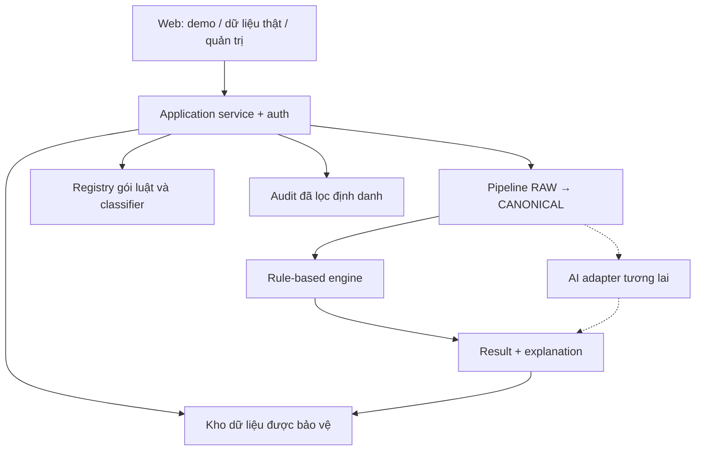

# Kiến trúc và hợp đồng triển khai

## Phương án tối giản

Giữ Python/YAML; engine độc lập với UI. Một backend ứng dụng với module nội bộ là đủ MVP. Streamlit đang có có thể dùng cho demo/pilot; bổ sung API/service dùng chung để UI, batch và classifier tương lai gọi cùng logic. Chưa chọn framework HTTP, auth provider, DB hoặc hosting; lập ADR D-09 trước khi triển khai phần phụ thuộc.



Các lớp là ranh giới trách nhiệm, không yêu cầu triển khai thành các service mạng riêng.

## Module đề xuất

| Module | Trách nhiệm |
| --- | --- |
| Ingestion | Đọc file/envelope, giới hạn kích thước, tách metadata/nhãn và tạo record key |
| Validation | RAW trước mapping; CANONICAL sau mapping; lỗi có path/code/severity |
| Mapping/preprocessing | Chuyển đổi theo config, tính biến từ nguồn xác định, giữ missing/provenance |
| Identity/export policy | Liên kết người bệnh trong phạm vi cho phép, loại định danh theo mục đích |
| Rule engine | Đánh giá luật/phụ thuộc, chọn kết luận, trace không chứa PII |
| Knowledge registry | Gói bất biến, lifecycle, active pointer, validation tương thích |
| Application/API | Auth, quyền, batch/run, pin phiên bản, điều phối và cancellation |
| Explanation | Render bằng chứng/nguồn an toàn từ snapshot đã cấp quyền và trace |
| Evaluation | So sánh nhãn độc lập, thống kê đầy đủ status/error và từng lớp |
| Audit/observability | Sự kiện, version, timing, actor; không ghi payload bệnh án |

Tái sử dụng `src/classify.py`, triển khai các file đang trống. Chỉ đổi cấu trúc thư mục khi có lợi rõ ràng; không di chuyển mọi file trước khi sửa lỗi.

## Ba lớp dữ liệu

1. **RAW:** biểu mẫu nguồn, envelope, dữ liệu nhận; chưa đảm bảo type/shape của engine.
2. **CANONICAL:** dữ kiện suy diễn đã chuẩn hóa, không chứa nhãn thật hoặc PII không cần thiết; giữ unknown/null, nguồn và version.
3. **Result:** kết luận/status và bằng chứng từ một snapshot CANONICAL cụ thể cùng package/engine version.

Provenance nên lưu riêng khỏi dictionary dữ kiện classifier để không làm engine đọc metadata. Giữ distinction missing/unknown/not-applicable; applicability chưa chốt không được tự biến N/A thành FALSE.

Ví dụ envelope đích (đề xuất; không phải input hiện tại đã hỗ trợ):

```json
{
  "record_id": "REC-001",
  "source_schema_version": "raw-1.0.0",
  "data_revision": 1,
  "du_lieu": {"tuoi": 30, "huyet_ap_tam_thu_thap_nhat": null},
  "metadata": {"source_record_key": "source-01:row-1"}
}
```

`record_id` là khóa kỹ thuật mỗi record, không phải ID người bệnh. Nếu cần liên kết nhiều lần khám, dùng `patient_token_id` riêng theo chính sách. Không tạo cùng token `UNKNOWN` cho mọi record thiếu ID; giữ trạng thái không biết liên kết, không giả lập là cùng bệnh nhân.

## Hợp đồng validation và trạng thái

| Trạng thái record | Trách nhiệm / hành vi |
| --- | --- |
| INVALID_DATA | Pipeline phát hiện sai contract không thể suy diễn; lưu lỗi có path, không đưa vào classifier |
| NEEDS_REVIEW | Mapping/ngưỡng/applicability chưa rõ, mâu thuẫn cần xác nhận; hoặc engine thấy conflict/invalid operand ở luật chặn |
| INSUFFICIENT_DATA | Thiếu dữ kiện có thể đổi kết luận hoặc thiếu test/thời gian; trường cần bổ sung rõ |
| OUT_OF_SCOPE | Chỉ khi có bằng chứng không đạt phạm vi đã được duyệt; không phủ định bệnh |
| CLASSIFIED | Có kết luận đủ bằng chứng theo phiên bản đang dùng |
| UNRESOLVED | Trong các kiểm tra áp dụng, không luật đích phù hợp và không UNKNOWN chặn |

Contract sai → INVALID_DATA trước; mapping/tiêu chí mơ hồ → NEEDS_REVIEW; chỉ thiếu theo contract → INSUFFICIENT_DATA. Giữ tất cả issues dù có một status chính. Không chặn cả record chỉ vì trường thiếu không ảnh hưởng kết luận. Chính sách cohort OUT_OF_SCOPE phải chốt D-05/D-06, không suy từ thiếu trường.

Đây là phân biệt pipeline đích; engine hiện tại vẫn có thể trả NEEDS_REVIEW cho kiểu sai khi được gọi trực tiếp. Adapter không được che/massage kết quả để làm đẹp báo cáo.

## Output contract chung

Giữ tương thích các trường public engine đang có; bổ sung envelope version thay vì đổi nghĩa trường âm thầm. Tên dưới đây là đề xuất cần schema và test:

```json
{
  "result_schema_version": "1.0.0",
  "run_id": "RUN-001",
  "record_id": "REC-001",
  "input_revision": 1,
  "classifier_id": "rule-based",
  "classifier_version": "engine-1.0.0",
  "knowledge_package_id": "kb-1.3.0",
  "knowledge_package_hash": "sha256:...",
  "status": "INSUFFICIENT_DATA",
  "predicted_label": null,
  "matched_rule_id": null,
  "matched_rule_ids": [],
  "blocking_rule_ids": ["R-SOC"],
  "missing_fields": ["huyet_ap_tam_thu_thap_nhat"],
  "explanation": {"summary": "Cần bổ sung dữ kiện để đánh giá luật ưu tiên cao."},
  "issues": [],
  "execution_time_ms": 4
}
```

Ví dụ trên chỉ minh họa envelope, không phải bệnh án đầy đủ hay output fixture. AI sau này dùng `model_version`/artifact hash và scores có label mapping; không giả lập matched_rule_id. `knowledge_package_id` có thể null cho classifier không dùng gói luật, nhưng schema/mapping/feature versions vẫn phải pin.

Các error envelope cần `error_code`, message an toàn, record_id/path nếu xác định; không trả stack trace/path hệ thống cho web public.

## API đề xuất

| Endpoint logic | Quyền / hành vi |
| --- | --- |
| `GET /demo/cases` | Public; chỉ dữ liệu giả |
| `POST /demo/classify` | Public; input giới hạn, rate limit, không lưu payload mặc định |
| `POST /imports` | Auth; upload và validate, trả import_id và lỗi |
| `GET /imports/{id}` | Chỉ phạm vi được cấp, preview và issues |
| `POST /runs` | Auth; import/record snapshot + package version; trả run_id |
| `GET /runs/{id}` | Auth; progress/status/counts, không leak batch khác |
| `GET /runs/{id}/results` | Auth; pagination/filter và kiểm tra quyền từng phạm vi |
| `POST /runs/{id}/exports` | Auth và quyền export, audit và policy |
| `POST /knowledge/drafts` | Quyền soạn luật |
| `POST /knowledge/{id}/compare` | Bộ ca giả/được phép; không gửi dữ liệu ra ngoài |
| `POST /knowledge/{id}/approve` | Người được phép duyệt, record approvals |
| `POST /knowledge/{id}/activate` | Quyền release; chỉ bản approved; atomic pointer switch |

Đây là danh sách chức năng, không bắt buộc REST literal nếu ADR chọn giao thức khác. Public demo chỉ dùng release được công bố; không cho caller activate luật tùy ý.

## Lưu trữ và vận hành

Entity tối thiểu: users/permissions, import, record revision, run, record result, knowledge package, rule revision, approval, audit event. Liên kết bằng ID, tránh duplicate raw PII vào result/log.

- Run có lifecycle QUEUED/RUNNING/COMPLETED/FAILED/CANCELLED, tách khỏi status của record.
- Một run completed vẫn có record invalid/needs review; completed không có nghĩa tất cả classified.
- Import/run retry có idempotency key; tránh duplicate khi bấm lại hoặc mạng timeout.
- Batch pin cả package và engine build; pin cấu hình ngày đánh giá/timezone nếu công thức phụ thuộc.
- Resolve/pin package/schema/mapping/preprocessing trước RAW validation và chuẩn hóa, không đợi đến inference. Import đã chuẩn hóa giữ provenance/version; run dùng đúng bộ tương thích đó. Muốn chạy phiên bản mapping mới phải tạo lượt reprocess từ RAW được phép lưu hoặc import lại, không áp gói mới âm thầm lên CANONICAL cũ.
- Không cần hàng đợi phân tán cho batch nhỏ; nếu async, task và kết quả phải có ownership, timeout và recovery.
- Xóa dữ liệu theo policy phải gồm raw/canonical/results/exports và xử lý backup theo thời hạn đã chốt.
- Lưu hash có thể giúp kiểm tra integrity nhưng không phải biện pháp khử định danh.

Phiên bản schema/mapping không tương thích phải fail rõ, không tự chọn adapter mới. Migration lưu trữ phải giữ kết quả lịch sử cùng version hoặc có export/backup và kế hoạch khôi phục.
