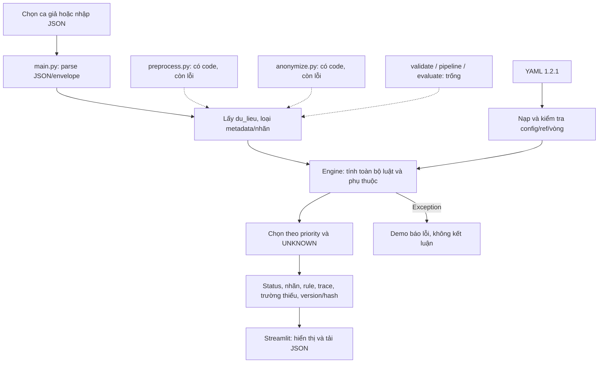
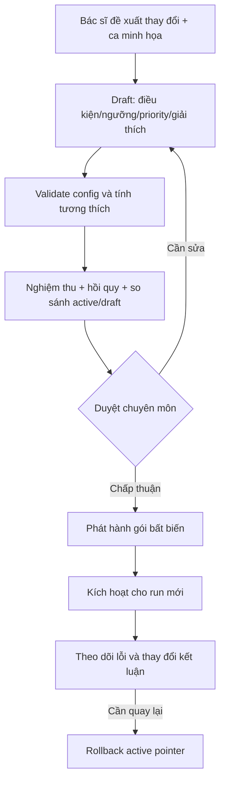
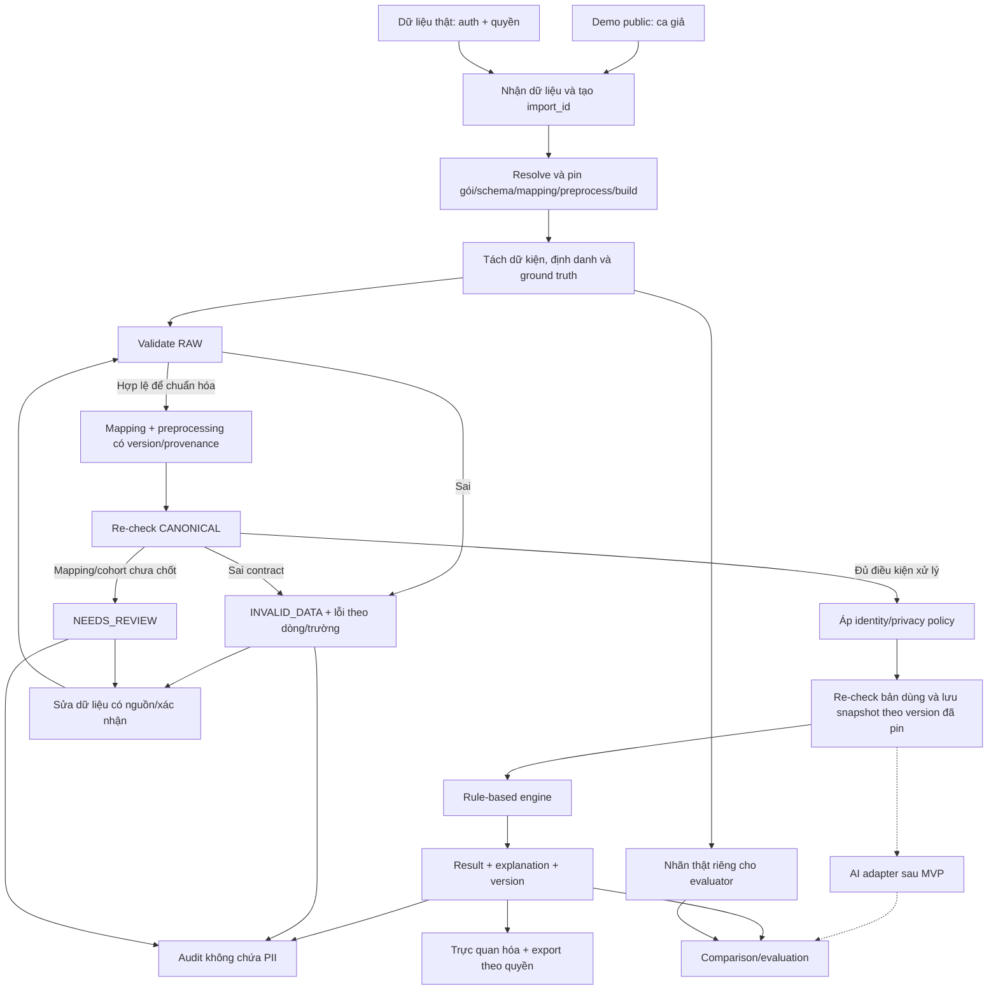
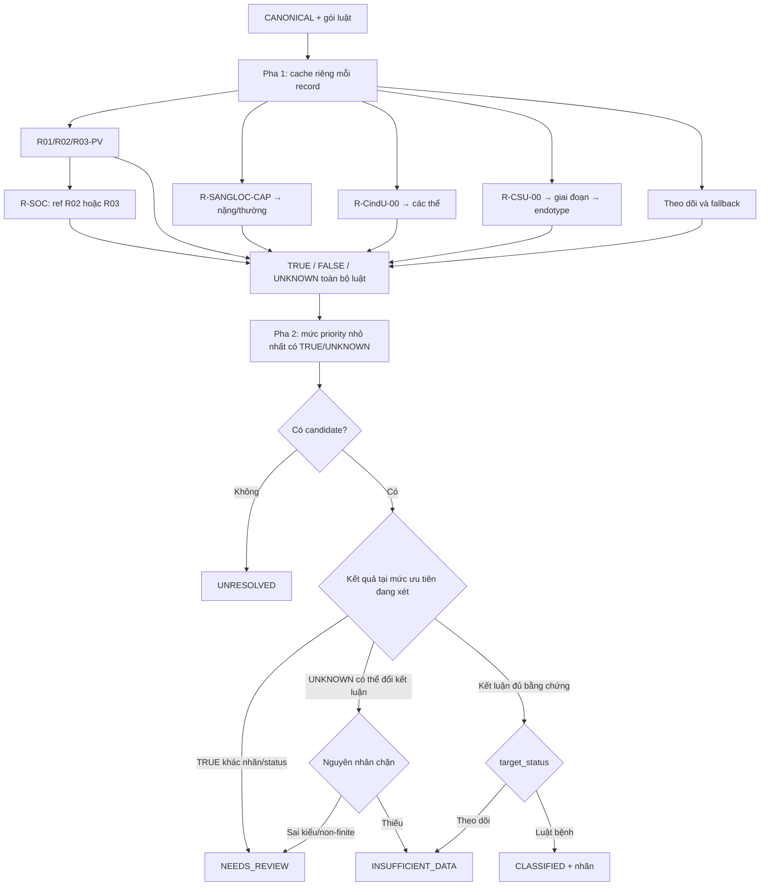
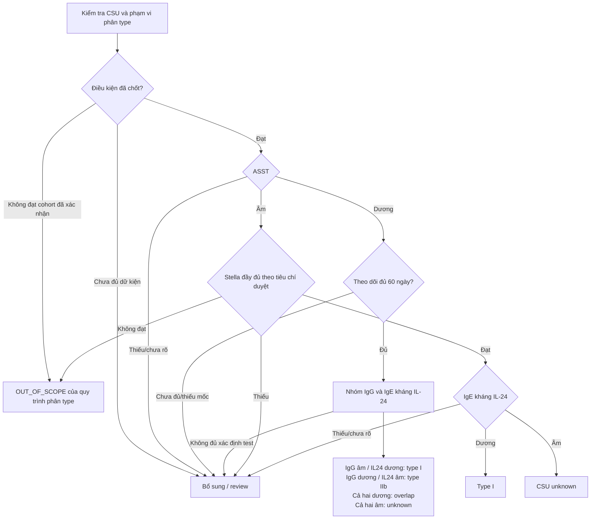

# Workflow và pipeline

## A. Luồng hiện tại tại baseline

Nét liền là luồng đang chạy; nét đứt là module chưa nối hoặc chưa triển khai. Không gọi sơ đồ này là pipeline đầy đủ.

## B. Workflow thay đổi yêu cầu chuyên môn

Những phần DSL đã hỗ trợ có thể cập nhật qua YAML/form. Biến mới cần dictionary/schema/mapping; toán tử/công thức mới cần code và test. Không nhập script Python tùy ý để đạt flexible.

## C. Pipeline đích của từng bệnh án/batch

Dữ kiện thiếu hợp lệ có thể đi vào engine và trả INSUFFICIENT_DATA. Không đặt gate đòi mọi field có giá trị trước khi chạy. Không dùng thiếu dữ kiện để suy bệnh ngoài phạm vi.

### Quy định từng bước

1. **Tiếp nhận:** kiểm tra quyền, kích thước/file type, tạo ID và đếm record; resolve và pin toàn bộ version trước validation/mapping; lưu bản gốc chỉ theo policy. Nếu version import và run khác, phải kiểm tra compatibility hoặc reprocess theo bộ mới, không tự đổi adapter.
2. **Tách:** nhãn/file name/chẩn đoán đích không tham gia feature; identity mapping giữ riêng và được bảo vệ.
3. **RAW validation:** kiểm tra cấu trúc nguồn có thể mapping, không áp schema canonical vào raw legacy.
4. **Mapping/preprocess:** chỉ dùng mapping được duyệt; mỗi biến dẫn xuất ghi nguồn và công thức. Ngày khám cố định, không thay bằng clock runtime.
5. **CANONICAL validation:** type/enum/range/đơn vị/quan hệ trường; bảo toàn missing và phát hiện mâu thuẫn.
6. **Privacy:** tính feature cần ngày trước khi lược bỏ ngày; loại định danh không cần cho classifier. Các token có phạm vi và khóa được quản lý.
7. **Re-check:** bản dữ kiện thực sự dùng vẫn đủ nguồn và đúng schema đã pin; lưu input revision/snapshot cùng package/build. Xác minh toàn bộ bước vừa chạy dùng đúng version đã resolve lúc tiếp nhận.
8. **Engine:** tính phụ thuộc và ba trạng thái, sau đó chọn kết luận; giữ trace không chứa giá trị nguồn.
9. **Trình bày:** lắp bằng chứng từ snapshot theo quyền; hiển thị unknown/blockers và việc cần làm.
10. **Audit/evaluate:** ghi version/actor/provenance; giữ lỗi/chưa kết luận trong báo cáo. Ground truth chỉ join sau inference bằng record key.

## D. Workflow suy diễn: phụ thuộc trước, ưu tiên sau

| Tầng | Priority baseline | Nhóm |
| --- | --- | --- |
| T1 | 1 | Sốc phản vệ |
| T2 | 2 / 3 | Phản vệ / theo dõi phản vệ |
| T3 | 4 / 5 | Cấp nặng / cấp thường |
| T4 | 6 | CIndU |
| T5 | 7 | CSU |
| T6 | 8 / 99 | Fallback / unresolved |

Engine tính toàn bộ, không dừng khi gặp TRUE đầu tiên trong YAML. Cùng nhãn/status có thể dùng rule_id nhỏ nhất làm đại diện; giữ tất cả matched IDs. Unknown cùng priority chỉ không chặn khi không thể thêm kết luận khác; unknown thấp hơn không chặn kết luận cao hơn đã đủ.

## E. Cây CSU để đối chiếu yêu cầu

Đây là cây **đích theo tài liệu**, không khẳng định YAML baseline đã thực hiện mọi nhánh. Điều kiện vào cohort, Stella và OUT_OF_SCOPE còn cần bác sĩ chốt. YAML baseline dùng `stella_dat OR IgE < 40`, khác đặc tả đầy đủ.

Nhóm IgG dương nếu ít nhất một test dương; âm nếu cả hai âm. Không tự áp điều kiện 60 ngày của giai đoạn 1 vào giai đoạn 2. Không coi OUT_OF_SCOPE là không mắc CSU. Các số/điều kiện trên lấy từ repo, không thay cho thẩm định y khoa.
