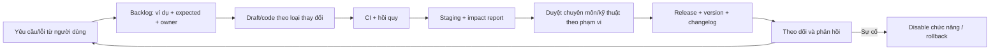

# Cập nhật liên tục và lộ trình AI

## Quy trình yêu cầu mới

| Loại thay đổi | Workflow |
| --- | --- |
| Ngưỡng/điều kiện/priority | Rule revision, ca nghiệm thu, compare, bác sĩ duyệt, package release |
| Thêm field/biểu mẫu | Schema/dictionary/mapping/provenance, compatibility/migration, package release |
| Engine bug | Regression failing → fix → impact cả package đang hỗ trợ → engine build mới |
| UI/API | Contract/access/UI tests → staging → app release; không đổi clinical config ngầm |
| Model AI | Model registry/version, feature contract, shadow comparison, review trước mở phạm vi |
| Incident | Cô lập chức năng, rollback tương thích, postmortem và test tái hiện |

## Nhịp vận hành đề xuất

- Một backlog chung có priority, scope, acceptance, dependency và quyết định còn mở.
- Chu kỳ hai tuần để chọn/hoàn thành task; họp bác sĩ theo lịch có thể tham gia.
- Release nhỏ khi đủ gate, không ép clinical change vào lịch nếu chưa duyệt.
- Hotfix xử lý incident riêng nhưng vẫn test và ghi version; không sửa live YAML tại chỗ.
- Changelog viết cho người dùng/reviewer, chỉ rõ thay đổi kết luận hoặc contract và cách rollback.

Đây là nhịp đề xuất, chưa phải cam kết nhân lực/lịch. Không bắt người dùng phê duyệt từng refactor nhỏ; phân quyền approval theo loại thay đổi.

## Theo dõi sau release

| Chỉ số | Cách dùng |
| --- | --- |
| Import invalid / execution errors | Phát hiện lỗi cấu trúc, template và phần mềm |
| Tỷ lệ từng status | Theo dõi missing/applicability; không tối ưu riêng classified rate |
| Đổi nhãn/status giữa phiên bản | Tìm tác động cần bác sĩ review |
| Ca ưu tiên cao đổi kết luận | Review có trọng tâm, không tự coi là cải thiện |
| Batch duration/timeout/retry | Điều chỉnh vận hành dựa trên tải thật |
| Feedback bác sĩ, lý do bất đồng | Chuyển thành issue có case giả/được phép |
| Precision/recall/F1 khi có ground truth | Theo từng lớp và evaluation protocol |

Dashboard/log phải dùng ID kỹ thuật và aggregate phù hợp, không leak clinical values vào analytics public. Metrics drift là tín hiệu điều tra, không tự kích hoạt sửa luật.

## Chuẩn bị AI trong MVP

Giữ interface classifier nhận CANONICAL snapshot và classifier config đã pin, trả result contract chung. Chỉ implement rule-based trước; không cần interface registry tổng quát phức tạp.

Các version cần pin khi thêm AI: model artifact, feature/schema/mapping/preprocessing, label taxonomy, inference code và calibration nếu có. Model không dùng rules thì knowledge_package_id có thể null; input pipeline versions vẫn có.

## Lộ trình AI sau MVP

1. **Dữ liệu đánh giá:** có quyền sử dụng, nhãn tham chiếu độc lập, hướng dẫn adjudication và taxonomy.
2. **Protocol:** split theo bệnh nhân, tránh lần khám của cùng người rơi vào nhiều tập; xét temporal/external validation theo mục tiêu.
3. **Adapter:** một model chạy trên cùng CANONICAL hoặc feature transform có version; không ăn nhãn/file name/record metadata gợi đáp án.
4. **Shadow mode:** AI chạy song song, chưa thay kết luận đang phục vụ; kết quả lưu riêng và so sánh.
5. **Review bất đồng:** bác sĩ xem ca rule đúng/AI sai, AI đúng/rule sai, cả hai sai/chưa xác định.
6. **Mở phạm vi:** chỉ sau evaluation, điều kiện vận hành và chính sách dữ liệu được duyệt. Ensemble là một classifier/version mới, có test và gate riêng.

Không mặc định gửi bệnh án thật đến API AI bên ngoài. Việc này cần quyết định rõ về dịch vụ, quyền, dữ liệu đưa đi và retention; không thể suy từ yêu cầu tương lai là đã được phép.

## Báo cáo so sánh

- Chạy cùng record snapshot, taxonomy và tiêu chí eligibility; log exclusions/errors rõ.
- Ground truth tách khỏi inference; rule-based không mặc nhiên là truth để chấm AI.
- Báo confusion matrix, precision/recall/F1 từng lớp, macro/weighted theo quy ước đã ghi.
- Báo coverage, abstention/insufficient/error rates và mẫu số; nếu metric chỉ trên classified subset phải ghi rõ, kèm báo cáo toàn bộ cohort.
- Xem recall lớp sốc/phản vệ và các nhầm lẫn liên quan riêng, không chỉ overall accuracy.
- Nếu probabilities được dùng, đánh giá calibration/thresholds trên protocol đã duyệt.
- Giải thích AI ghi phương pháp và giới hạn, không giả lập là proof theo rule trace hoặc quan hệ nhân quả.

AI scores không được trộn với rule matching thành một con số confidence tùy ý. Quyết định kết hợp rule/AI cần thiết kế chuyên môn và version riêng.

## Quản lý kết quả lịch sử

Không cập nhật result cũ khi model/luật mới xuất hiện. Tạo run mới, so sánh có link bản trước; labels đổi taxonomy phải có bảng mapping/version. Dữ liệu và consent/policy thay đổi có thể buộc xóa snapshot; báo giới hạn rerun thay vì giữ dữ liệu trái policy.
